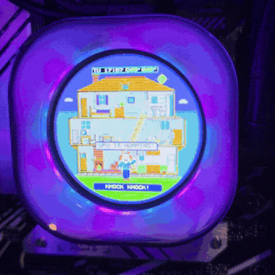
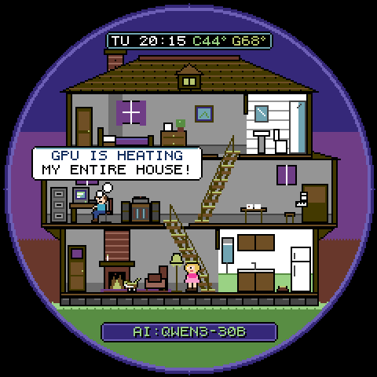

# Corsair TITAN LCD for Linux + Little Computer Person 2026 (`corsair-titan-lcd-linux`)

<p align="center">
  &nbsp;&nbsp;
</p>
<p align="center"><em>Left: Live on a physical Corsair TITAN 360 RX cooler on Ubuntu &nbsp;•&nbsp; Right: Direct 480×480 multi-venue feed</em></p>

A fast, zero-bloat Linux display engine for **Corsair iCUE LINK TITAN RX LCD** (and compatible circular `480×480` Corsair AIO pump screens) powered by **[OpenLinkHub](https://github.com/jurkovic-nikola/OpenLinkHub)** — headlined by **LCP 2026 (Modern Edition)**, a full town-and-life evolution of Activision's 1985 Commodore 64 classic ***Little Computer People*** (*"House-on-a-Disk"*), plus **12 horological, avionics, retro-CRT, and workstation telemetry faces** AND a standalone **GTK4 Desktop Widget & Studio** that runs on *any* Linux PC even without a Corsair cooler!

---

## What's New in LCP 2026 (Modern Edition)

- **Realistic Wall-Clock & Calendar Life Schedule (`auto` mode)**
  - **Monday – Friday (`09:00 – 17:00`)**: Walks out his front door, hops into his electric fastback, and commutes to his **9–5 Fleet & Tech Shift** (with an occasional `12:35` lunchtime nip out to **Greggs**!).
  - **Weekday & Sunday Evenings**: Commutes back home at `17:00` for cozy evenings by the fire, coding on his rig, hanging out with his girlfriend **Chloe** & terrier **Buddy**, or nipping out for a quick gym session or pint before bed.
  - **Saturday & Sunday (`0%` Work!)**:Strictly off-duty all weekend — lazy morning lie-ins followed by autonomous trips across **11 animated pixel-art venues**.
- **Walks Out & Drives His EV Car Between Every Venue (`driving`)**
  - Whenever his destination changes, he walks down the stairs to the front door and drives his Arctic-silver **2026 EV Fastback** (spinning diamond-cut alloys, gold calipers, Buddy's head poking out the rear window with flapping ears, and scrolling green road signs) to the next location.
- **11 Animated Pixel-Art Venues + 75+ Funny Thought Bubbles**
  - **3-Story Cutaway Home** • **9–5 Fleet & Tech Hub** • **High Street (Greggs, Tech Store & Mart)** • **The Red Lion UK Pub** (hand-pulled ales, live football TV & dartboard) • **Pulse 24/7 Fitness Gym** (power rack & neon treadmills) • **IMAX Cinema** (animated sci-fi space battle & popcorn) • **Seaside Pier & 99 Flake Ice-Cream Van** • **Club SID 2026** (spinning disco ball, sweeping lasers & lit dancefloor) • **Grand Boutique Hotel** (marble concierge & skyline penthouse) • **Starlight Bistro Date** • **3-Story House Party** (fairy lights, balloons, pizza & dancing guests).
  - **Context-Aware 2-Line Comic Thought Clouds:** Quips dynamically about traffic, molten-lava steak bakes, £7.50 pub pints, leg day, movie trailers, and your GPU heating his entire house when an AI model is running!
- **Standalone GTK4 + Libadwaita Desktop Studio & Mini Circular Widget (`lcp_desktop_app.py`)**
  - Customize skin tone, hair color, everyday outfits, girlfriend's name, simulation speed, and schedule rules, or click **`🪟 Mini Widget`** to dock a live `480×480` circular companion right on any Linux laptop/desktop screen — with or without Corsair hardware!
- **Sub-30ms Second Accuracy & Live Animation on OpenLinkHub**
  - Pairs `POST /api/lcd/upload` + `POST /api/lcd/image` over a persistent **HTTP/1.1 keep-alive** socket (**~11 ms total**) with wall-clock phase-locking (`floor(time.time()) + 1.006s`) and zero-config hardware auto-discovery.

---

## All 13 Circular `480×480` Display Themes

| Theme ID | Display Name | Description |
| :--- | :--- | :--- |
| `c64_lcp` | **Little Computer Person 2026** | Autonomous resident, Chloe, terrier Buddy, EV car commutes, 11 venues & funny thoughts (~4.6 FPS) |
| `chrono_pulse` | **Neon Chrono & Pulse** | 60-tick precision dial, sweeping neon seconds arc, digital clock & live temps (1 Hz) |
| `swiss_tourbillon` | **Swiss Skeleton Chrono** | Champagne-gold mechanical watch face, lollipop crimson seconds hand & CPU/GPU sub-dials (1 Hz) |
| `cooling_cockpit` | **Cryo Dual-Loop Cockpit** | Opposing CPU & GPU thermal gauges, giant Coolant °C, Pump & Case Fan RPMs |
| `ai_fleet` | **AI Fleet & VRAM HUD** | Active local LLM (`llama-server`) / ComfyUI / Whisper model, VRAM bar & compute rings |
| `tensor_reactor` | **Tensor Arc Reactor** | 24-blade sci-fi turbine arc reactor pulsing with live GPU wattage, VRAM & load |
| `motorsport_gt` | **Motorsport GT Gauge** | 270° racing tachometer needle, redline zone & digital telemetry box |
| `stealth_zen` | **Stealth Minimal OLED** | Pure `#000000` zero-glare studio face with crisp `HH:MM` and `CPU • GPU • LIQ` triad |
| `hx1200i_power_grid` | **Digital PSU Power Plant** | Live Corsair digital PSU wattage meter, `+12V / 5V / 3.3V` rail split & Zero-RPM Eco badge |
| `silicon_matrix` | **Silicon Compute Matrix** | Live per-thread CPU logic-analyzer spectrum, peak GHz / GPU MHz clocks & RAM/VRAM arcs |
| `cyber_radar` | **Tactical Sonar Sweep** | Rotating 360° phosphor radar sweep, 4-quadrant thermal blips & live Network ↓/↑ (1 Hz) |
| `pip_os_3000` | **Amber CRT Terminal** | Retro phosphor monochrome terminal with CRT scanlines, `HH:MM:SS` & 12-block gauges (1 Hz) |
| `horizon_avionics` | **Jet Glass Cockpit ADI** | Fighter-jet artificial horizon banking/pitching with compute load, flight clock & CPU/GPU tapes (1 Hz) |

---

## Quick Start

```bash
# Ubuntu / Debian dependencies (Pillow + GTK4/Libadwaita for the Desktop Studio/Widget)
sudo apt install python3-pil fonts-dejavu-core python3-gi gir1.2-gtk-4.0 gir1.2-adw-1

git clone https://github.com/martynmcintee-tech/corsair-titan-lcd-linux.git
cd corsair-titan-lcd-linux
chmod +x install.sh
./install.sh
```

### CLI & Desktop Companion Commands

```bash
# Launch the GTK4 LCP 2026 Studio (venues, wardrobe, schedule & live circular viewfinder)
lcp-2026

# Launch as a compact circular Desktop Widget (works on ANY Linux PC, even without a cooler!)
lcp-2026 --widget

# Switch Corsair AIO LCD themes via CLI
titan-lcd --list-themes
titan-lcd --set-theme c64_lcp
titan-lcd --set-theme swiss_tourbillon
titan-lcd --brightness 80
```

---

## Environment Variables (Optional)

| Variable | Default | Description |
| :--- | :--- | :--- |
| `OPENLINKHUB_HOST` | `127.0.0.1` | OpenLinkHub HTTP bind address |
| `OPENLINKHUB_PORT` | `27003` | OpenLinkHub HTTP port |
| `OPENLINKHUB_HUB_SERIAL` | *(auto-discovered)* | Override iCUE LINK Hub `deviceId` |
| `OPENLINKHUB_LCD_CHANNEL` | *(auto-discovered)* | Override LCD channel ID (e.g. `17`) |
| `LCP_USER_NAME` | `$USER` | Customizes the Little Computer Person's glass-knock greeting (e.g. `HI ALEX!`) |
| `LLAMA_MODELS_URL` | `http://127.0.0.1:18436/models` | Optional `llama.cpp` router `/models` endpoint for live GGUF HUD telemetry |
| `LLAMA_API_KEY` | *(empty)* | Optional Bearer token for `LLAMA_MODELS_URL` |
| `COMFY_URL` | `http://127.0.0.1:8188` | Optional ComfyUI endpoint for active diffusion/video telemetry |

---

## License

Released under the [MIT License](LICENSE). *Little Computer People* (1985) was created by David Crane and Rich Gold at Activision; all pixel sprites, town venues, and code in this repository are clean-room original procedural artwork created as a fan tribute.
