# Corsair TITAN LCD for Linux (`corsair-titan-lcd-linux`)

<p align="center">
  
</p>

A fast, zero-bloat Linux display engine for **Corsair iCUE LINK TITAN RX LCD** (and compatible circular `480×480` Corsair AIO pump screens) powered by **[OpenLinkHub](https://github.com/jurkovic-nikola/OpenLinkHub)** — headlined by a live, autonomous homage to Activision's 1985 Commodore 64 classic ***Little Computer People*** (*"House-on-a-Disk"*), plus **12 horological, avionics, retro-CRT, and workstation telemetry faces**.

---

## Highlights

- **1985 Commodore 64 *Little Computer People* Cutaway House (`c64_lcp`)**
  - Rendered natively at `240×240` strictly in Philip Timmermann's (**Pepto**) 16-color **VIC-II** palette and integer-upscaled (`2× NEAREST` → `480×480` in **~0.23 ms/frame**), streaming smoothly at **~4.6 FPS**.
  - **3-Story Furnished Dollhouse:** Pitched shingled roof with dormer & smoking brick chimney; upstairs bedroom (bed, alarm clock, curtains, closet) + tiled bathroom; middle-floor study with breadbin **Commodore 64 + glowing 1702 monitor**, spinning vinyl stereo, card table, and upright piano; ground-floor living room with crackling 3-frame brick fireplace + armchair + floor lamp, diagonal staircases, and kitchen with wall **water tank**, sink, opening lit fridge, and dog bowl.
  - **Autonomous Resident & Pet Terrier (Not a Video Loop!):** Weighted-random state machines + multi-floor staircase pathfinding for both your pixel resident and his terrier. He types on his C64, plays floating musical notes on the piano, reads the newspaper by the fire, raids the fridge, spins records, pets the dog, sleeps upstairs at night (`Zzz`), and periodically walks front-and-center to **knock on your pump glass** (`TAP! TAP!` with pixel ripples) and wave!
  - **Reacts to Your Real PC & Clock:** Day, dusk, and starry-night skies track your local clock; loading a local LLM or pushing GPU utilization `>15%` draws him straight to his C64 desk; coolant °C drives the kitchen water-tank level; and CPU/GPU `>85°C` triggers the classic 1985 C64 `$5` green "sick" face easter egg.
- **Sub-30ms Second Accuracy & Live Animation on OpenLinkHub**
  - OpenLinkHub's iCUE LINK Hub driver (`lsh.Device`) caches a heap-allocated image snapshot in `d.lcdImage[channel]` and only refreshes that pointer when `POST /api/lcd/image` is called after `POST /api/lcd/upload`.
  - `OpenLinkHubClient` pairs both calls over a persistent **HTTP/1.1 keep-alive** socket (**~11 ms total**) with a background `TelemetryPoller` thread and wall-clock phase-locking (`floor(time.time()) + 1.006s`), so watch second hands never drift or skip a beat.
- **Zero-Config Hardware Auto-Discovery**
  - Automatically discovers your Corsair iCUE LINK Hub serial, AIO LCD channel, fan channels, and digital PSU rails from `http://127.0.0.1:27003/api/devices/`, plus your CPU & GPU model names (with graceful fallback on non-NVIDIA systems).

---

## All 13 Circular `480×480` Display Themes

| Theme ID | Display Name | Description |
| :--- | :--- | :--- |
| `c64_lcp` | **Little Computer Person** | 1985 C64 3-story cutaway house with autonomous pixel resident & pet dog (~4.6 FPS) |
| `chrono_pulse` | **Neon Chrono & Pulse** | 60-tick precision dial, sweeping neon seconds arc, digital clock & live temps (1 Hz) |
| `swiss_tourbillon` | **Swiss Skeleton Chrono** | Champagne-gold mechanical watch face, lollipop crimson seconds hand & CPU/GPU sub-dials (1 Hz) |
| `cooling_cockpit` | **Cryo Dual-Loop Cockpit** | Opposing CPU & GPU thermal gauges, giant Coolant °C, Pump & Case Fan RPMs |
| `ai_fleet` | **AI Fleet & VRAM HUD** | Active local LLM (`llama-server`) / ComfyUI / Whisper model, VRAM bar & compute rings |
| `tensor_reactor` | **Tensor Arc Reactor** | 24-blade sci-fi turbine arc reactor pulsing with live GPU wattage, VRAM & load |
| `motorsport_gt` | **Motorsport GT Gauge** | 270° racing tachometer needle, redline zone & digital telemetry box |
| `stealth_zen` | **Stealth Minimal OLED** | Pure `#000000` zero-glare studio face with crisp `HH:MM` and `CPU • GPU • LIQ` triad |
| `hx1200i_power_grid` | **Digital PSU Power Plant** | Live Corsair digital PSU wattage meter, `+12V / 5V / 3.3V` rail split & Zero-RPM Eco badge |
| `silicon_matrix` | **Silicon Compute Matrix** | Live per-thread CPU logic-analyzer spectrum, peak GHz / GPU MHz clocks & RAM/VRAM arcs |
| `cyber_radar` | **Tactical Sonar Sweep** | Rotating 360° phosphor radar sweep, 4-quadrant thermal blips & live Network ↓/↑ (1 Hz) |
| `pip_os_3000` | **Amber CRT Terminal** | Retro phosphor monochrome terminal with CRT scanlines, `HH:MM:SS` & 12-block gauges (1 Hz) |
| `horizon_avionics` | **Jet Glass Cockpit ADI** | Fighter-jet artificial horizon banking/pitching with compute load, flight clock & CPU/GPU tapes (1 Hz) |

---

## Prerequisites

1. **Linux** with **[OpenLinkHub](https://github.com/jurkovic-nikola/OpenLinkHub)** running (`http://127.0.0.1:27003` WebUI/REST enabled).
2. **Python 3.10+** and **Pillow** (`python3-pil` on Ubuntu/Debian or `pip install Pillow`), plus `fonts-dejavu-core`.

```bash
sudo apt install python3-pil fonts-dejavu-core
```

---

## Quick Start & Installation

### Run directly or install as a `systemd --user` service

```bash
git clone https://github.com/MartynMcIntee/corsair-titan-lcd-linux.git
cd corsair-titan-lcd-linux
chmod +x install.sh
./install.sh
```

Or run manually without installing:

```bash
python3 titan_lcd_llm_hud.py
```

### Switching Themes & Brightness

State is persisted in `~/.config/titan-lcd/state.json` and picked up by the running daemon in **< 50 ms**:

```bash
# List all 13 themes
titan-lcd --list-themes

# Switch to a specific display
titan-lcd --set-theme c64_lcp
titan-lcd --set-theme swiss_tourbillon
titan-lcd --set-theme horizon_avionics

# Cycle to the next theme, or auto-cycle all 13 displays every 15s
titan-lcd --set-theme next
titan-lcd --set-theme cycle

# Adjust LCD screen brightness (0-100%)
titan-lcd --brightness 60
```

A live `480×480` PNG mirror of the active pump frame is also written to `/dev/shm/titan_lcd_current.png` for desktop previews or widgets.

---

## Optional Environment Variables

| Variable | Default | Purpose |
| :--- | :--- | :--- |
| `OPENLINKHUB_HOST` / `OPENLINKHUB_PORT` | `127.0.0.1` / `27003` | OpenLinkHub REST API address |
| `OPENLINKHUB_SERIAL` | *(auto-discovered)* | Override Corsair Hub serial if multiple hubs are attached |
| `OPENLINKHUB_LCD_CHANNEL` | *(auto-discovered)* | Override LCD channel ID (e.g. `17`) |
| `LCP_USER_NAME` | *(optional)* | Customizes the Little Computer Person's glass-knock greeting (e.g. `HI ALEX!`) |
| `LLAMA_MODELS_URL` | `http://127.0.0.1:18436/models` | Optional `llama.cpp` router `/models` endpoint for live GGUF HUD telemetry |
| `LLAMA_API_KEY` | *(empty)* | Optional Bearer token for `LLAMA_MODELS_URL` |
| `COMFY_URL` | `http://127.0.0.1:8188` | Optional ComfyUI endpoint for active diffusion/video telemetry |

---

## License

Released under the [MIT License](LICENSE). *Little Computer People* (1985) was created by David Crane and Rich Gold at Activision; all pixel sprites and code in `lcp_c64_house.py` are clean-room original procedural artwork created as a fan tribute.
